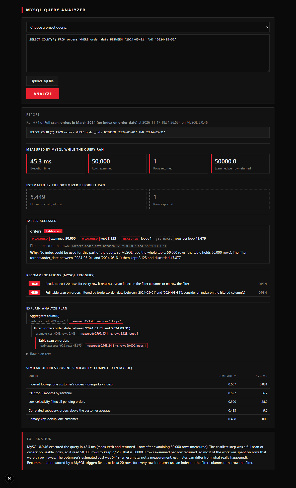
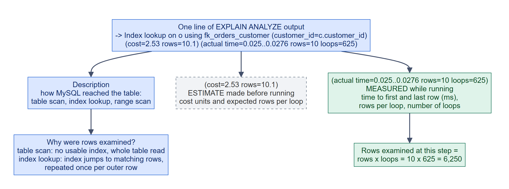
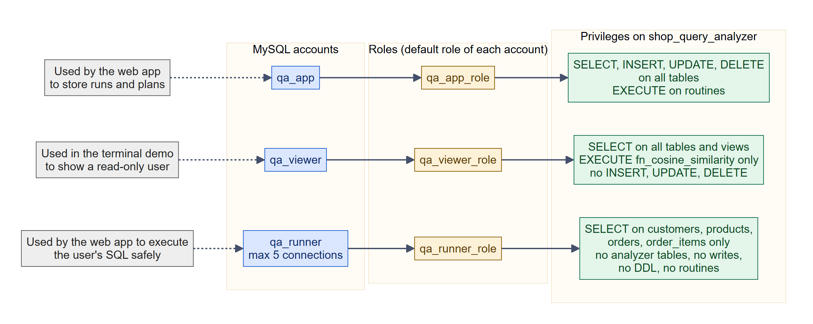

# MySQL Query Analyzer

A one-page web app that runs a SQL query on a **real MySQL 8.0 database**, shows how MySQL executed it (the actual `EXPLAIN ANALYZE` plan), and explains why rows were examined. The web app and the MySQL terminal use the **same database**, `shop_query_analyzer`.



## What you can do

| On the page | What happens in MySQL |
|---|---|
| Pick a preset, paste SQL or upload a `.sql` file, press Analyze | `EXPLAIN ANALYZE` executes the query as a read-only account |
| Read the report | Measured time, rows examined versus returned, access method, index, filter and the reason, kept apart from the optimizer's estimates; the actual plan; recommendations; similar queries |
| Compare runs, rank queries | In the MySQL terminal: `CALL sp_compare_executions(a, b)` and `CALL sp_workload_priority(10)` (see the demo guide) |

## How it fits together


## What happens when you press Analyze


## Measured values versus estimates

Every plan line has two brackets. The estimate is a guess made before running; the measured part was counted while MySQL executed the query. The page labels them differently and only ever treats measured values as results.



## Database

Nine tables: the four shop tables and five analyzer tables.


Three accounts with different privileges, enforced by MySQL:



## Setup (once)

Needs Node.js 20 or newer and the MySQL 8.0 service running on port 3306.

1. Install packages:

```bash
npm install
```

2. Enter your MySQL root password **locally**. It is never typed into chat and never committed. In PowerShell, in this project folder:

```bash
copy .env.local.example .env.local
notepad .env.local
```

   Replace `PUT_YOUR_ROOT_PASSWORD_HERE` with your root password, keep the double quotes, save, close. `.env.local` is ignored by Git.

3. Create the database, tables, data, accounts and permissions (root is used for this step only):

```bash
npm run setup
```

   This never drops anything. If a database called `shop_query_analyzer` already exists and is not this project's, it stops and changes nothing. It generates passwords for the three restricted accounts and saves them to `.env.local`.

4. Record measured sample runs (real `EXPLAIN ANALYZE` executions of the preset queries):

```bash
npm run warmup
```

5. Start the page and open http://localhost:3200 (black and red page: a query box, an Analyze button, then the report):

```bash
npm run dev
```

## Files

| Path | Purpose |
|---|---|
| `sql/01_schema.sql` to `sql/10_crud_demo.sql` | Setup, seed data, stored logic, permissions, presets, three queries, index before/after, cleanup, DDL and CRUD demos |
| `lib/` | SQL guard, plan parser, analysis pipeline, database pools |
| `app/` | The one-page interface and its four API routes |
| `scripts/` | `setup`, `warmup` and a helper to run the `mysql` client with the saved password |
| `docs/REPORT.md` | Complete technical report |
| `docs/DEMO_GUIDE.md` | Live-demo script with exact commands |

Run a terminal command with a saved password without typing it: `npm run mysql -- --as root -e "SHOW DATABASES"`.
