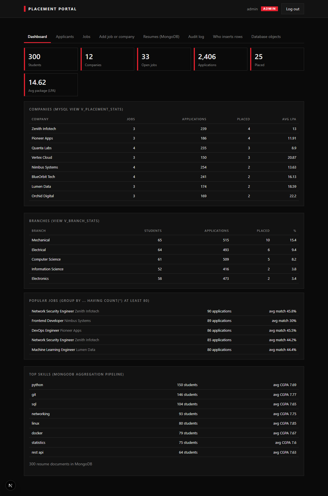
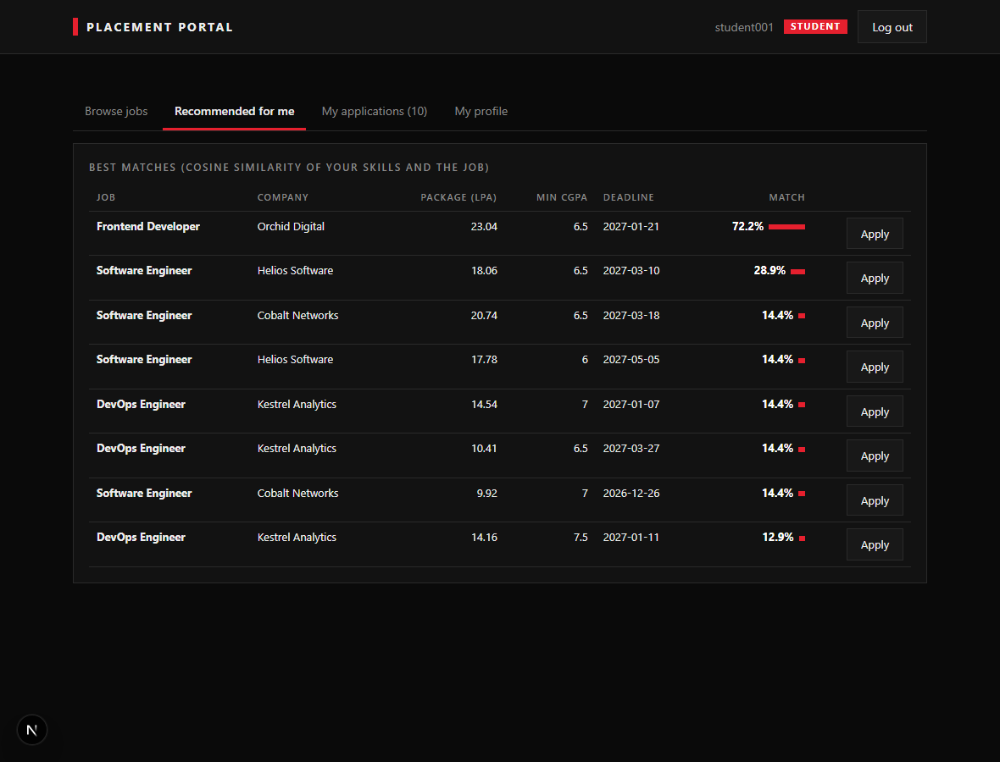
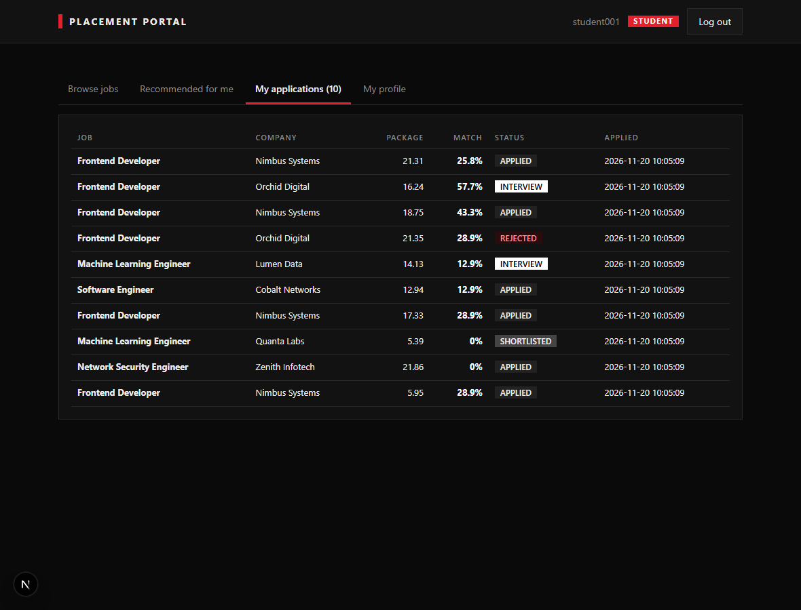
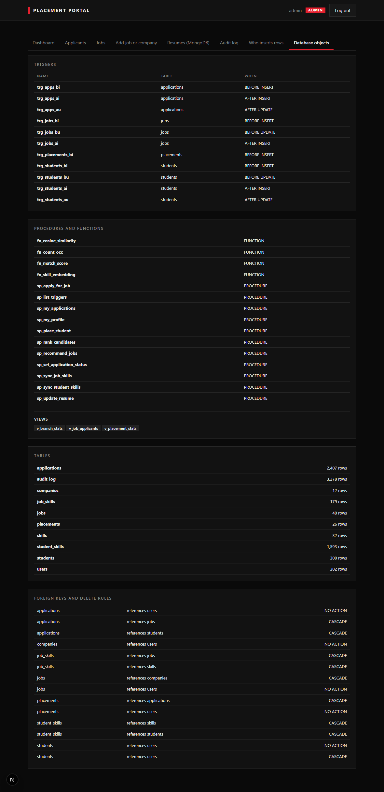
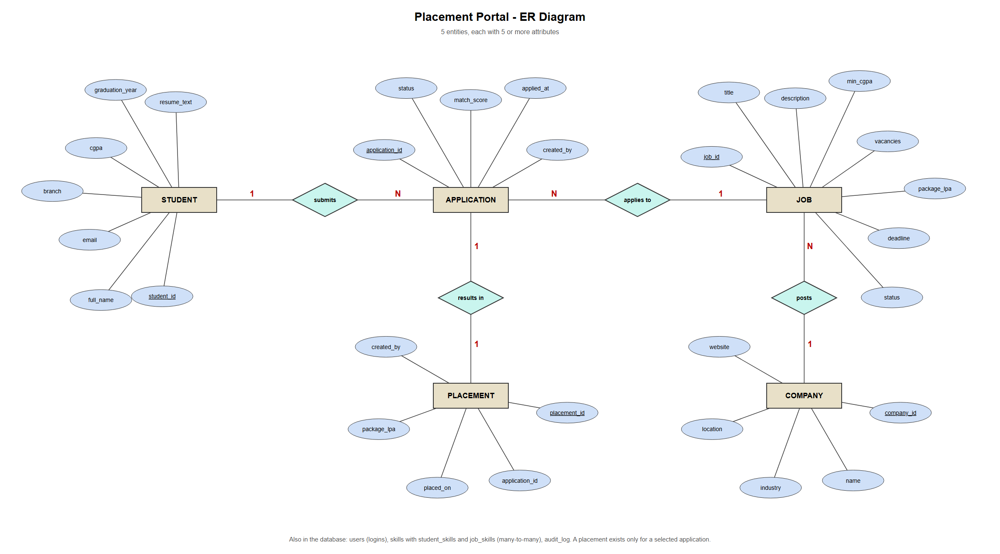

# Placement Portal

A campus placement management system. The placement officer (admin) posts companies and jobs; students log in, browse and apply; the database enforces the rules and **ranks candidates for each job by skill match**.

Databases: **MySQL 8.0** (relational data, rules, triggers, procedures, roles), **MongoDB** (resume documents and an event log), and **vector similarity** (cosine similarity on skill vectors, computed inside MySQL).



## Roles and who inserts the rows

| Role | Logs in as | Can do | Inserts into |
|---|---|---|---|
| **Admin** (placement officer) | `admin` | Add companies and jobs, see ranked applicants, change statuses, place students, read the audit log | `companies`, `jobs`, `students`, `placements` |
| **Student** | `student001` ... `student300` | Browse and search jobs, see recommended jobs, apply, edit own resume | `applications` (through a stored procedure) |
| **MySQL triggers** | automatic | Check eligibility, compute vectors, keep skill links in step | `audit_log`, `student_skills`, `job_skills` |

Every main table stores `created_by`, the user who inserted the row, so "who inserted this?" is a query, not a guess. The admin page has a tab **Who inserts rows** that shows it.

Demo logins: `admin / admin123` and `student001 / student123` (all students use `student123`). Passwords are stored as bcrypt hashes.

## Screens

| Student: recommended jobs (vector similarity) | Student: my applications |
|---|---|
|  |  |

Admin tabs: dashboard (MySQL views and a MongoDB aggregation), ranked applicants, jobs, add job or company, resume search (MongoDB text index), audit log, who inserts rows, database objects (triggers, procedures, views, foreign keys).



## ER diagram



## The database

| Table | Purpose |
|---|---|
| `users` | Logins and roles (admin, student); bcrypt password hashes |
| `students` | Profile, CGPA, resume text, skill vector |
| `companies`, `jobs` | Employers and openings, with minimum CGPA, vacancies, deadline, skill vector |
| `skills`, `student_skills`, `job_skills` | 32 skills and the two many-to-many links |
| `applications` | One row per student per job; status and match score |
| `placements` | A placed student |
| `audit_log` | Every important change and who made it |

Constraints: primary and foreign keys with `CASCADE` or default restrict, `UNIQUE` (one application per student per job), `CHECK` (CGPA 0 to 10, vacancies at least 0, package above 0), `ENUM` statuses.

### Logic inside MySQL

| Kind | Objects |
|---|---|
| Triggers | `trg_apps_bi` refuses an application if the job is closed, the deadline passed or CGPA is below the minimum, and computes the match score; audit triggers on applications, jobs and resumes; triggers that rebuild the skill vector and skill links when a resume or job description changes; `trg_placements_bi` stops a student being placed twice |
| Procedures | `sp_apply_for_job`, `sp_place_student` (one transaction), `sp_set_application_status`, `sp_rank_candidates`, `sp_recommend_jobs`, `sp_update_resume`, `sp_my_profile`, `sp_my_applications`, `sp_list_triggers`, two skill sync procedures |
| Functions | `fn_skill_embedding`, `fn_cosine_similarity`, `fn_match_score`, `fn_count_occ` |
| Views | `v_job_applicants`, `v_placement_stats`, `v_branch_stats` |
| Accounts | `pp_auth` (reads users only), `pp_admin` (data access, no DDL), `pp_student` (reads public job data and calls five procedures; no insert, update or delete on any table) |

The web app connects to MySQL as the account that matches the logged-in user's role, so MySQL itself refuses anything the role may not do.

### MongoDB (database `placement_portal_docs`)

- `resumes`: one document per student (skills, projects, certifications, resume text). Indexes: unique `student_id`, multikey `skills`, compound `branch` + `cgpa`, text index on `resume_text` and `full_name`.
- `events`: log of applications, resume updates, postings and placements.
- Used for: the resume editor (projects and certifications), full-text resume search, and the "top skills" aggregation on the dashboard.

### Vector similarity

A resume or job description becomes a 32-number vector counting mentions of 32 skills (`fn_skill_embedding`, maintained by triggers). `fn_cosine_similarity` compares two vectors. The match score is `100 x cosine similarity`. It ranks applicants for a job and recommends jobs to a student. It is a transparent skill-count embedding, not a machine-learning model.

## Setup (once)

Needs Node.js 20 or newer, the MySQL 8.0 service on port 3306 and a local MongoDB (default `mongodb://127.0.0.1:27017`, no login).

1. `npm install`
2. Create `.env.local` from `.env.local.example` and enter your MySQL root password **locally** (never in chat, never committed):
   ```bash
   copy .env.local.example .env.local
   notepad .env.local
   ```
3. `npm run setup` creates the database `placement_portal`, tables, logic, accounts, grants, sample data (300 students, 40 jobs, 12 companies, about 2,400 applications, 25 placements) and the MongoDB documents. It never drops anything and leaves other databases alone. It takes a few minutes.
4. `npm run dev`, then open http://localhost:3300

## Files

| Path | Purpose |
|---|---|
| `sql/01_schema.sql`, `02_logic.sql`, `03_roles.sql` | Tables, functions, procedures, triggers, views, roles |
| `scripts/setup.mjs` | Creates everything and loads the sample data |
| `lib/` | Database pools per role, MongoDB helpers, login and permission guard |
| `app/` | Login, student page, admin page and the API routes |
| `docs/COMMANDS.txt` | Presentation commands |
