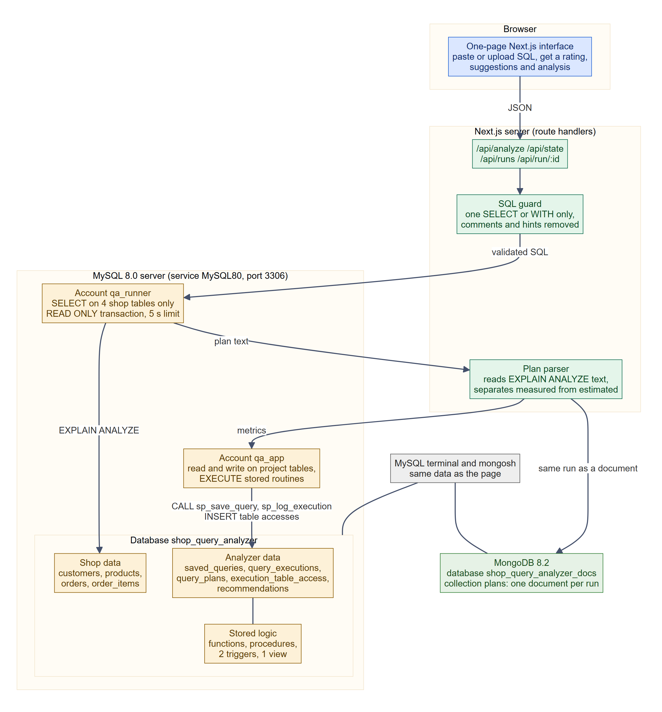
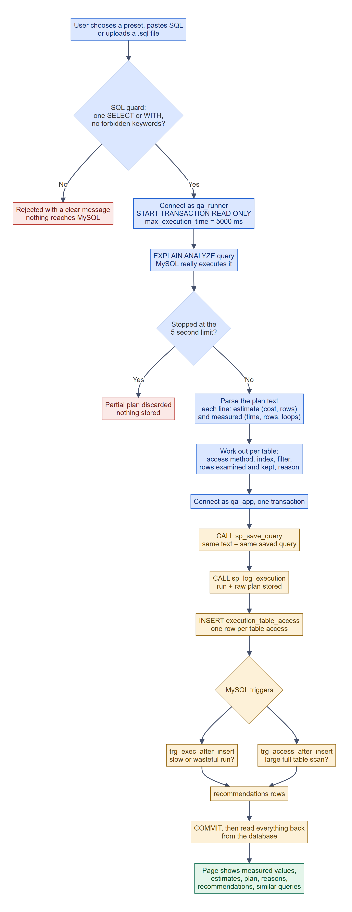
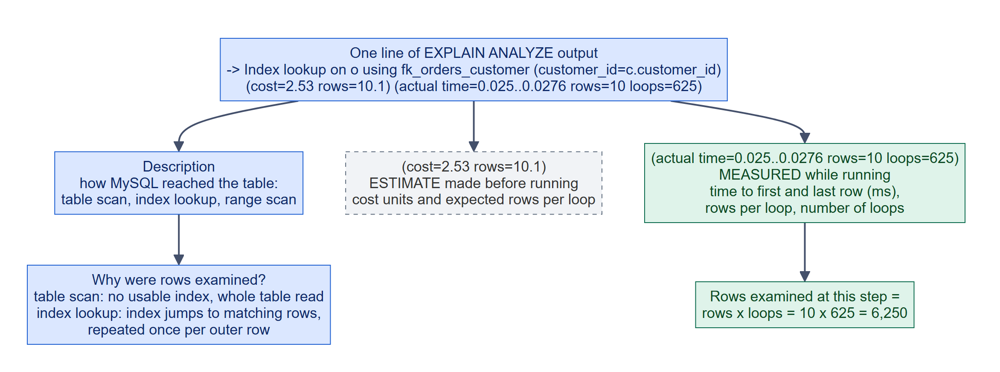
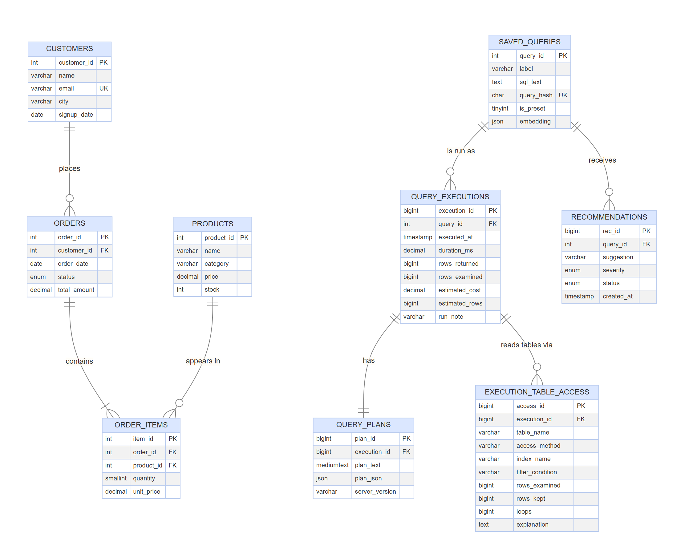

# MySQL Query Analyzer: technical report

DBMS mini project, MySQL 8.0.46 (Community Server), Next.js 16, Node.js 22.

## 1. Problem and idea

A slow query is only useful to fix if you know why it is slow. MySQL can execute a query and report, for every step of its plan, how long the step really took and how many rows it handled (`EXPLAIN ANALYZE`). This project turns that report into an application:

1. run a query on a realistic shop database,
2. store the measured run, its plan and the tables it touched,
3. explain in plain language why rows were examined,
4. compare two runs (for example before and after adding an index) with a stored procedure,
5. rank stored queries by **total cost over time** (how often a query runs multiplied by how long it takes), because repeated moderately slow queries often waste more than one very slow query.

Everything lives in one real MySQL database, `shop_query_analyzer`. The web page and the MySQL terminal read and write the same tables.

## 2. Architecture

| Layer | Component | Responsibility |
|---|---|---|
| Browser | One-page Next.js interface (`app/page.js`, `app/components.js`), black and red | A query box and an Analyze button; shows the report: measured and estimated values, tables accessed with reasons, plan, recommendations, similar queries |
| Server | Route handlers (`app/api/*`) | `/api/analyze` (used by the page), `/api/state` (preset list), `/api/runs` and `/api/run/:id` (read stored runs) |
| Server | `lib/sqlguard.mjs` | Accepts exactly one `SELECT` or `WITH ... SELECT`; removes comments and optimizer hints; rejects write, DDL and file keywords |
| Server | `lib/plan.mjs` | Parses `EXPLAIN ANALYZE` text, splits estimates from measurements, builds per-table reasons |
| Server | `lib/analyzer.mjs` | Runs the pipeline and reads results back from MySQL |
| MySQL | Account `qa_runner` | Executes user SQL: `SELECT` on four tables only, read-only transaction, 5 second limit |
| MySQL | Account `qa_app` | Stores runs through stored procedures and table inserts |
| MySQL | Account `qa_viewer`, root | Terminal demonstration and setup |
| MySQL | Stored logic | 3 functions (one is a helper), 4 procedures, 2 triggers, 1 view |

## 3. Workflow

Reading one plan line:

Rows examined at a step are `rows x loops` from the measured bracket. MySQL prints `rows` as a rounded per-loop average, so for steps that loop many times the product is accurate to about the rounding of that average (see limitations).

## 4. ER model

Relationships: one customer places many orders; an order contains many items; a product appears in many items; a saved query is run many times; each run has exactly one stored plan and many table-access rows; a saved query receives many recommendations.

### Table attributes

**customers** (5,000 rows)

| Column | Type | Constraint |
|---|---|---|
| customer_id | INT UNSIGNED | PRIMARY KEY, AUTO_INCREMENT |
| name | VARCHAR(60) | NOT NULL |
| email | VARCHAR(100) | NOT NULL, UNIQUE |
| city | VARCHAR(30) | NOT NULL |
| signup_date | DATE | NOT NULL |

**products** (500 rows)

| Column | Type | Constraint |
|---|---|---|
| product_id | INT UNSIGNED | PRIMARY KEY, AUTO_INCREMENT |
| name | VARCHAR(80) | NOT NULL |
| category | VARCHAR(20) | NOT NULL |
| price | DECIMAL(8,2) | NOT NULL, CHECK price > 0 |
| stock | INT | NOT NULL DEFAULT 0, CHECK stock >= 0 |

**orders** (50,000 rows)

| Column | Type | Constraint |
|---|---|---|
| order_id | INT UNSIGNED | PRIMARY KEY, AUTO_INCREMENT |
| customer_id | INT UNSIGNED | NOT NULL, FOREIGN KEY to customers (RESTRICT); InnoDB adds an index automatically |
| order_date | DATE | NOT NULL (deliberately not indexed) |
| status | ENUM('PENDING','PAID','SHIPPED','CANCELLED') | NOT NULL DEFAULT 'PENDING' (not indexed) |
| total_amount | DECIMAL(10,2) | NOT NULL, CHECK >= 0 |

**order_items** (150,000 rows)

| Column | Type | Constraint |
|---|---|---|
| item_id | INT UNSIGNED | PRIMARY KEY, AUTO_INCREMENT |
| order_id | INT UNSIGNED | NOT NULL, FOREIGN KEY to orders (CASCADE) |
| product_id | INT UNSIGNED | NOT NULL, FOREIGN KEY to products (RESTRICT) |
| quantity | SMALLINT UNSIGNED | NOT NULL, CHECK > 0 |
| unit_price | DECIMAL(8,2) | NOT NULL, CHECK > 0 |

**saved_queries**

| Column | Type | Constraint |
|---|---|---|
| query_id | INT UNSIGNED | PRIMARY KEY |
| label | VARCHAR(100) | NOT NULL |
| sql_text | TEXT | NOT NULL |
| query_hash | CHAR(64) | NOT NULL, UNIQUE (SHA-256 of the normalised text) |
| is_preset | TINYINT(1) | CHECK IN (0, 1) |
| embedding | JSON | NOT NULL (30 numbers, see section 6) |
| created_at | TIMESTAMP | DEFAULT CURRENT_TIMESTAMP |

**query_executions** (one row per run)

| Column | Type | Meaning |
|---|---|---|
| execution_id | BIGINT UNSIGNED | PRIMARY KEY |
| query_id | INT UNSIGNED | FOREIGN KEY to saved_queries (CASCADE) |
| executed_at | TIMESTAMP(3) | when it ran |
| duration_ms | DECIMAL(12,3) | MEASURED, root node of the plan, CHECK >= 0 |
| rows_returned | BIGINT UNSIGNED | MEASURED |
| rows_examined | BIGINT UNSIGNED | MEASURED, sum over base-table accesses |
| estimated_cost | DECIMAL(16,2) | ESTIMATE from the optimizer (may be NULL) |
| estimated_rows | BIGINT UNSIGNED | ESTIMATE (may be NULL) |
| run_note | VARCHAR(100) | optional label such as "before index" |

**query_plans**: plan_id (PK), execution_id (UNIQUE, FK, CASCADE), plan_text (the raw `EXPLAIN ANALYZE` text), plan_json (parsed nodes), server_version.

**execution_table_access** (one row per table access in a plan): access_id (PK), execution_id (FK, CASCADE), table_name, table_alias, access_method (`Table scan`, `Index lookup`, `Single-row index lookup`, `Index range scan`, `Index scan`, `Constant row`), index_name, index_condition, filter_condition, estimated_rows (ESTIMATE), rows_examined (MEASURED), rows_kept (MEASURED, after the filter), loops (MEASURED), explanation (generated from the measured values).

**recommendations**: rec_id (PK), query_id (FK, CASCADE), execution_id, suggestion, severity ENUM('LOW','MEDIUM','HIGH'), status ENUM('OPEN','APPLIED','DISMISSED'), created_at; `UNIQUE (query_id, suggestion)` prevents duplicate advice.

## 5. SQL concepts used

| Concept | Where |
|---|---|
| DDL with PK, FK (RESTRICT, CASCADE), UNIQUE, CHECK, ENUM, DEFAULT, JSON, composite and secondary indexes | `sql/01_schema.sql` |
| `INSERT ... WITH RECURSIVE ... SELECT` with deterministic arithmetic (no `RAND()`) | `sql/02_seed.sql` |
| `INSERT`, `UPDATE`, `DELETE`, `SELECT` | `sql/10_crud_demo.sql`, the application's inserts and reads |
| Joins, aggregation, `GROUP BY`, window functions (`RANK() OVER`, `SUM() OVER`) | `sql/06_three_queries.sql` Q1, `v_workload_priority` |
| Correlated subqueries | Q2 |
| CTE, correlated and scalar subqueries, `LIKE` | preset queries in `sql/05_presets.sql` |
| `JSON_TABLE` | `fn_cosine_similarity` |
| Stored **functions** | `fn_count_occ`, `fn_query_embedding`, `fn_cosine_similarity` |
| Stored **procedures** | `sp_save_query`, `sp_log_execution`, `sp_compare_executions`, `sp_workload_priority` |
| **Triggers** | `trg_exec_after_insert` (wasteful or slow run), `trg_access_after_insert` (large table scan) |
| **View** | `v_workload_priority` |
| Users, roles, `GRANT`, `SET DEFAULT ROLE`, `SHOW GRANTS` | `sql/04_permissions.sql` |
| `EXPLAIN ANALYZE`, `ANALYZE TABLE`, `CREATE/DROP INDEX` | `sql/07_index_before_after.sql`, the application |
| Safe `CREATE TABLE`, `ALTER TABLE`, `DROP TABLE` | `sql/09_ddl_demo.sql` |
| Prepared statement for conditional DDL | `sql/08_index_cleanup.sql` |

## 6. The next-generation feature: cosine similarity in MySQL

MySQL 8.0 has no vector data type, so the feature is built from standard parts:

1. `fn_query_embedding(sql)` counts 30 constructs in the SQL text (`select`, `join`, `group by`, `order by`, `limit`, `where`, `like`, `in (`, `exists`, `with`, `count(`, `sum(`, `avg(`, `max(`, `distinct`, `between`, `having`, `union`, the four table names, and the columns `status`, `order_date`, `customer_id`, `category`, `city`, `email`, `total_amount`, `price`) and returns a JSON array.
2. `fn_cosine_similarity(a, b)` computes `(a . b) / (|a| |b|)` over the two arrays with `JSON_TABLE`.
3. The page and query Q3 list the five stored queries most similar to the one just analysed, with their average times.

This is a transparent structural embedding (counting features), not a machine-learning model. It finds queries that are shaped alike, which is what is useful for reusing a known fix.

## 7. Measured values versus estimates

| Value | Kind | Source |
|---|---|---|
| Execution time | measured | `actual time` of the root plan node |
| Rows returned | measured | `rows` of the root node |
| Rows examined | measured | sum over base-table access nodes of `rows x loops` |
| Rows kept after a filter | measured | `rows x loops` of the `Filter` node above the access |
| Loops | measured | `loops` |
| Optimizer cost, estimated rows | estimate | `(cost=... rows=...)` bracket, shown dashed in the interface |

Nothing is calculated from estimates and presented as a result. If a plan line has no number, the page says so instead of filling one in.

## 8. Safety of user-supplied SQL

Three independent layers:

1. **Guard (application):** one `SELECT` or `WITH ... SELECT`; comments (including `/*+ MAX_EXECUTION_TIME(...) */` hints) are removed; keywords such as `INSERT`, `UPDATE`, `DELETE`, `DROP`, `CREATE`, `INTO`, `OUTFILE`, `SLEEP`, `CALL`, `SET` are rejected; a semicolon in the middle is rejected.
2. **Privileges (MySQL):** the query runs as `qa_runner`, which can `SELECT` four tables and nothing else.
3. **Execution limits (MySQL):** `START TRANSACTION READ ONLY` and `SET SESSION max_execution_time = 5000`.

Finding made while testing: for `EXPLAIN ANALYZE`, MySQL does not raise an error when `max_execution_time` is reached; it returns a *partial* plan (for example an aggregate with `rows=0`). The application therefore treats any run that reaches the limit as timed out and discards it, so a truncated plan is never stored as a measurement.

## 9. What was tested, and the result

Environment: Windows 11, MySQL 8.0.46 service `MySQL80` on port 3306, Node.js 22.20.

| Test | Result |
|---|---|
| `npm run setup` on a server without the project database | Created database, 9 tables, 205,500 rows, 3 accounts, grants, presets; all three accounts logged in with their role active |
| `npm run setup` run a second time | Detected the existing project database, kept data and accounts, re-applied grants; the other databases (`company`, `hostel`, `nested`, `sample`, `smart_hostel`) untouched |
| `npm run warmup` | 72 measured runs of 11 presets stored; triggers created the recommendations |
| `EXPLAIN ANALYZE` format | Verified on the installed server before writing the parser; all 11 presets parsed and stored, and plan steps for which MySQL prints no numbers are shown as such, never filled in |
| Web page against the terminal | Counts of all 9 tables and the three newest runs (id, duration, rows examined) identical in the API response and in `SELECT` from the terminal |
| Custom query, query with comment and trailing `;`, CTE query | Accepted, stored, explained |
| `DELETE ...`, `WITH x AS (...) DELETE ...`, `SELECT 1; DROP TABLE ...`, `SELECT ... INTO OUTFILE` | Rejected by the guard, nothing reached MySQL |
| `SELECT * FROM mysql.user`, `SELECT * FROM saved_queries` | MySQL denied: `qa_runner` has no privilege |
| Heavy self-join with an optimizer hint trying to raise the timeout | Stopped after 5 seconds, partial plan discarded, nothing stored |
| Index before/after through the page | Table scan, 50,000 rows examined, about 16 ms; after `CREATE INDEX`: index range scan, 2,123 rows examined, about 1 ms; index dropped and confirmed gone |
| `sql/07` to `sql/10` run on the server | All completed; demonstration index and `demo_scratch` table removed; customers back to 5,000 |
| `qa_viewer`: `SELECT` allowed; `DELETE`, `INSERT`, `CALL sp_workload_priority` | `SELECT` worked; the other three denied (errors 1142, 1142, 1370) |
| Production build (`next build`) | Compiled; 4 API routes and the page |

Run times vary from run to run by a few milliseconds; the figures above are single runs, not benchmarks.

## 10. Limitations

- **Single runs are noisy.** Caching and other programs change timings; repeat a run before concluding from small differences. `duration_ms` is stored with 3 decimals, so sub-microsecond lookups show as 0.000.
- **Rows examined is derived from `rows x loops`.** MySQL prints the per-loop row count rounded, so for steps with very many loops the product can be slightly off. The raw plan text is stored, so it can be rechecked.
- **Estimates can be absent.** Some nodes (sort, temporary table, materialisation) have no cost bracket; the root cost may be `NULL`, shown as `n/a`.
- **Table detection uses the SQL text.** Aliases are read from `FROM` and `JOIN` clauses with a regular expression. Comma joins (`FROM a x, b y`) and derived tables are not resolved; accesses to temporary tables and CTEs are shown in the plan but not counted as base-table accesses.
- **Constant lookups.** A primary-key lookup is resolved during planning and appears as `Constant row` with 1 row; no scan is reported for it.
- **Not a CPU profiler.** CPU, I/O and buffer pool statistics are not collected.
- **`EXPLAIN ANALYZE` really executes the query.** The 5 second limit and read-only account bound the cost; a query that needs longer is rejected.
- **Embedding is structural.** Similarity reflects shape (constructs and names), not meaning.
- **Local, single-user.** No login, no admin page, intended for a demonstration on one machine; the application account passwords are stored in `.env.local`.
- **MySQL 8.0 specific.** The plan text format is parsed as printed by 8.0.46; a different major version may print differently.

## 11. Marking-criteria mapping

| Requirement | Where it is met |
|---|---|
| CREATE TABLE DDL and constraints, shown with `SHOW CREATE TABLE` | `sql/01_schema.sql`; demo guide section 1 |
| Three relevant queries | `sql/06_three_queries.sql` (priority ranking, table hotspots, cosine similarity); demo guide section 3 |
| At least one trigger, procedure and function (project specific) | `trg_exec_after_insert`, `trg_access_after_insert`; `sp_log_execution`, `sp_workload_priority`; `fn_cosine_similarity`; section 5 above |
| Two MySQL users/roles with different GRANT privileges | `qa_app`/`qa_app_role` versus `qa_viewer`/`qa_viewer_role` (plus `qa_runner`); `sql/04_permissions.sql`; demo guide section 2 |
| INSERT, UPDATE, DELETE, SELECT demonstrable | `sql/10_crud_demo.sql`; demo guide section 5 |
| Cosine similarity or another next-generation feature in MySQL | `fn_query_embedding`, `fn_cosine_similarity`; section 6 above |
| Useful real-world analysis prioritising repeated costly queries | `v_workload_priority`, `sp_workload_priority`, query Q1 in the terminal |
| Setup, seed, stored logic, permissions, queries scripts | `sql/01` to `sql/06` |
| Index before/after with actual plans, explicit cleanup | `sql/07_index_before_after.sql`, `sql/08_index_cleanup.sql`; demo guide section 6 |
| Safe CREATE/ALTER/DROP TABLE examples | `sql/09_ddl_demo.sql` |
| Web application reading and writing the same database | `lib/analyzer.mjs`, `app/`; section 9 parity test |
| Documentation | `README.md`, this report, `DEMO_GUIDE.md` |

## 12. How to run

See `README.md`: `npm install`, create `.env.local` with the root password (locally), `npm run setup`, `npm run warmup`, `npm run dev`, open http://localhost:3200.
